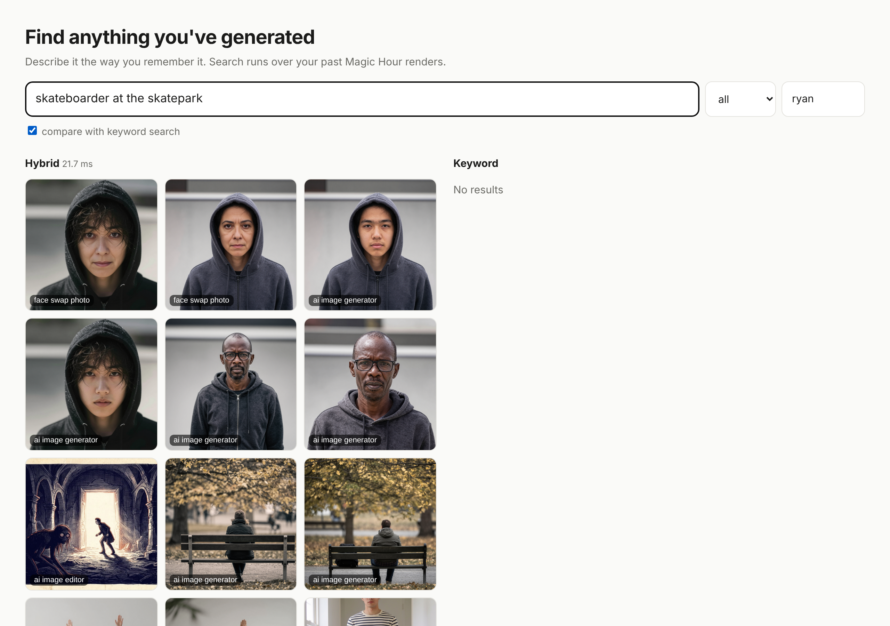
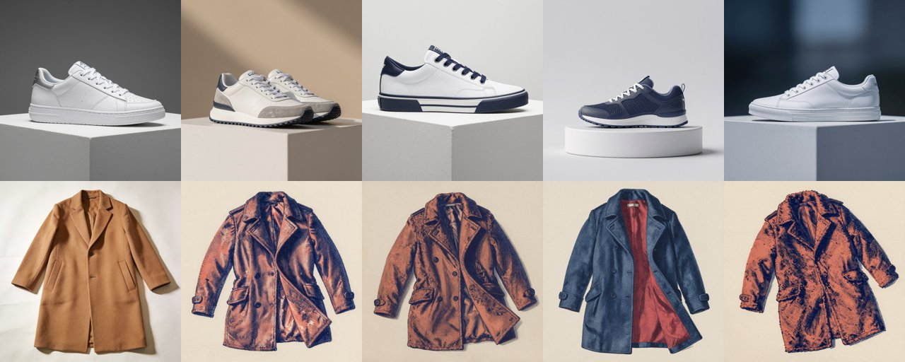

# asset-search

Plain-language search over everything you've generated with the Magic Hour API, plus one-click
variants of anything you find. Type "skateboarder at the skatepark" and get the render whose prompt
said "a person in a hoodie facing the camera on a skate ramp", even though keyword search returns nothing.
Pick a result and the app queues new renders through Magic Hour, each linked back to its source.



**Stack:** Python 3.13, FastAPI, PyTorch (own encoder, trained from scratch), Postgres 16 + pgvector 0.8
(HNSW over `halfvec(256)`, iterative scans) + Postgres full-text, Redis (query-vector cache, RQ queue),
Next.js 15 / TypeScript, Docker Compose.

## Results

### Search quality on a real generation library

The library is **389 real Magic Hour generations** from five earlier projects: images, face swaps,
image-to-video and text-to-video clips, music, and background-removed cutouts, each with the prompt or
inputs that produced it (`scripts/import_library.py`). Face swaps and cutouts have no prompt, so they
inherit text from their parent assets.

Queries are hand-written the way a person searches from memory. There are two sets:

* `eval/queries.tsv`: 138 dev queries, written before any model was trained, used for every design decision.
* `eval/queries_holdout.tsv`: 60 held-out queries, written after the first evaluation and before the fixes
  it motivated. They were scored once, at the end.

Held-out set:

| retriever | R@1 | R@10 | hit@10 | MRR@10 | nDCG@10 | no results |
|---|---|---|---|---|---|---|
| Keyword, all words (typical app search) | 0.37 | 0.34 | 0.37 | 0.37 | 0.34 | **63%** |
| Keyword, any word (BM25-style OR) | 0.82 | 0.90 | 0.97 | 0.87 | 0.86 | 0% |
| Vector (trained encoder) | 0.72 | 0.79 | 0.88 | 0.76 | 0.74 | 0% |
| **Hybrid (this repo)** | **0.95** | **0.93** | **0.98** | **0.96** | **0.92** | 0% |

Hybrid search puts the right asset first for 95% of held-out queries. A strict keyword box,
which is what most apps ship, returns nothing for 63% of them.

### Paraphrase retrieval: 3,000 held-out COCO images

Each image becomes one prompt-style asset (caption B plus style boilerplate). The query is a short search
built from caption A, which a different person wrote. There is exactly one right answer among 3,000.

| retriever | R@1 | R@10 | MRR@10 | no results |
|---|---|---|---|---|
| Keyword, all words | 0.02 | 0.04 | 0.03 | 83% |
| Keyword, any word | 0.12 | 0.32 | 0.17 | 0% |
| **Vector** | **0.28** | **0.63** | **0.39** | 0% |
| Hybrid | 0.22 | 0.58 | 0.32 | 0% |

The two benchmarks pull in opposite directions, which is why the fusion was tuned on both (see below).
On a real library people reuse words from their own prompts, so keyword evidence is strong. When
query and prompt were written by different people, only the vector side works: it doubles keyword
recall@10 here. The hybrid beats both retrievers on the real library and keeps 92% of the vector side's
recall@10 on COCO. Each single retriever falls far behind on one of the two benchmarks.

### Scale: 1M assets, 3,611 users

1,007,786 assets (COCO train/dev captions turned into prompts; no test images) spread over 3,611 users with
a heavy tail: 1 user with 100k assets, 10 with 20k, 100 with 3k, 1,500 with 200, 2,000 with 50. The HNSW
index (m=16, ef_construction=64, `halfvec(256)`) builds in **112 s** and takes 750 MB. Each tier ran 200
per-user queries at ef_search=100. Recall is measured against the exact per-user top 10.

| user size | exact scan | Postgres default plan | HNSW + iterative scan | **shipped** |
|---|---|---|---|---|
| 100,000 | 198 ms, recall 1.00 | 2.8 ms, recall **0.90**, 32% short | 2.5 ms, 0.97 | **2.4 ms p50 / 5.7 ms p99, recall 0.97** |
| 20,000 | 32 ms | 3.1 ms, recall **0.23**, 100% short | 7.2 ms, 0.97 | **6.3 ms / 16 ms, 0.97** |
| 3,000 | 4.0 ms | 2.5 ms, recall **0.39**, 64% short | 29 ms, 0.99 | **3.4 ms / 4.5 ms, 1.00** |
| 200 | 0.6 ms | 0.6 ms, 1.00 | **423 ms**, 0.99 | **0.7 ms / 1.4 ms, 1.00** |
| 50 | 0.5 ms | 0.5 ms, 1.00 | **783 ms**, 0.70 | **0.5 ms / 1.5 ms, 1.00** |

("short" means fewer than 10 results came back.)

This is the classic filtered-ANN trap, and it only shows up with a realistic user-size distribution.
For mid-sized users Postgres picks the HNSW index. The index returns its ef_search=100 nearest
neighbours across *all* users, the `user_id` filter throws nearly all of them away, and a user with
20,000 assets gets 2-3 results back, with recall@10 of 0.23. Forcing pgvector 0.8's iterative scan
everywhere fixes recall but makes small users slow, because the index walks the whole graph looking for
a user's 50 vectors (783 ms, and still incomplete). The shipped query sets
`hnsw.iterative_scan = relaxed_order` and leaves the plan to Postgres. Small users get an exact scan
through the `user_id` btree, large users get the index, and the iterative scan keeps going until it has
found 10 of that user's rows. The result is recall of 0.97 or better at every size, and p99 of 16 ms or
less. For the largest user that is 83x faster than an exact scan.

### Variants through Magic Hour

Variants come in two modes, and the UI lets the user pick one.

**Edit** sends the source image to Magic Hour's image editor (`nano-banana-2`) with an instruction
that says what to keep and what to change. The exact product, character or layout survives:


Top: a past product shot (left), then edits that change the setting and the lighting, and one that
re-renders it in another medium. Bottom: a past closet photo restyled "like my lithograph book illustration".
The planner retrieves the user's best-matching asset for that phrase (one of the *Time Machine* plates)
and borrows its style clauses.

**Regenerate** re-renders the prompt with text-to-image (`z-image-turbo`), varying the axes the original
prompt left open (time of day, framing, medium). It is ten times cheaper, but it keeps the idea, not
the object:



To measure how much of the source each mode keeps, `scripts/eval_variants.py` matches SIFT features
between source and output and counts RANSAC-verified geometric inliers:

| mode | images | median SIFT inliers vs source | outputs with 20+ inliers | credits / image |
|---|---|---|---|---|
| regenerate (`z-image-turbo`) | 8 | 6 | 0% | 5 |
| **edit** (`nano-banana-2`) | 6 | **31.5** | **83%** | 50 |

All 14 renders (340 credits) became searchable as children of their sources as soon as each job
finished.

## How it works

```
Next.js UI ──> FastAPI ──┬─> encoder (PyTorch, CPU, ~4 ms)  ──> Redis query-vector cache
                         ├─> Postgres: pgvector HNSW + sentence-chunk vectors + tsvector GIN
                         │      vector top-50 ⊕ keyword top-50 ──> coverage-weighted RRF
                         └─> RQ "variants" queue ──> worker ──> Magic Hour API ──> new child assets
```

**Encoder.** No pretrained weights were used. The encoder is word embeddings plus hashed
character 3/4-grams (fastText style, so typos and unseen words still embed), followed by a 2-layer
Transformer, mean pooling and a 256-d projection, about 20M parameters. It is trained with symmetric
in-batch InfoNCE on 36.5k COCO images (`assetsearch/encoder/`). Training pairs are shaped like the real task:

* the query side is 2-5 content words, sometimes with a typo or a style word ("watercolor", "cinematic");
* the prompt side is another annotator's caption plus style and quality boilerplate. 40% of prompts are
  long (several captions joined, plus "no text, no watermark…" filler), because real prompts run to 150 words.

**Chunks.** Prompts over 24 words also get one vector per sentence (`asset_chunks`), and an asset scores
by its best-matching piece. On the dev set this raised vector R@10 for the long book-plate prompts.

**Fusion.** Reciprocal rank fusion, with each keyword hit's vote scaled by `coverage³`, the share of
query words that hit actually contains. A hit that matches only "person" in "person at the farmers
market" barely counts, while one that matches every word counts fully. `kw_weight=4` and `power=3` were
picked by `scripts/tune_fusion.py` on the dev queries plus the COCO *dev* split. Neither test set was
used for tuning.

**Per-user filtering.** Every query is scoped to `user_id`. See the scale section for why that matters with HNSW.

**Variants.** `POST /users/{u}/assets/{id}/variants` plans the prompts or edit instructions, writes a
`variant_jobs` row and enqueues an RQ job.
The worker records each Magic Hour project id *before* it polls, so a retried job resumes polling renders
it already paid for instead of submitting (and paying for) them again. Outputs are downloaded and inserted
with `parent_ids` set, so lineage shows in the UI ("Made from" / "Variants and edits").

## What didn't work, and the fixes

* **First encoder lost to keyword search on the real library** (dev MRR 0.65 vs 0.86). It was trained only
  on 10-word captions, and the real prompts are 50-150 words with a shared 40-word style suffix that
  dominated the mean-pooled vector. The fix was to retrain on long, multi-caption prompts and add
  sentence-chunk vectors (`results/library_eval_v1.json` vs `library_eval_dev.json`).
* **Transformer collapsed to one output vector** in the first training run (loss stuck at log(batch)).
  The 0.02-std embeddings were swamped by the Transformer's residual stream. An input LayerNorm and a
  bag-of-words skip connection fixed it.
* **Plain RRF hurt paraphrase search.** A keyword weight that helps on the real library (where queries
  reuse prompt words) dragged COCO recall from 0.63 to 0.44, because "any word" matches on "a", "person"
  and "the". Coverage weighting recovered most of it.
* **Remaining misses:** rare words the encoder never saw in COCO ("ballerina" lands near
  "basketball" through shared n-grams), and assets whose text is generic (7 try-on photos all described
  as "virtual try-on"). The fix for those is an image-side embedding, which needs vision weights that
  were not available here.
* **The first variants regenerated rather than edited.** Text-to-image kept the subject and style but
  not the exact product: it produced a different sneaker every time. Edit mode (above) fixes that at
  10× the credits, so the UI offers both.
* **A style-borrowing bug.** The clause splitter matched "light" inside "slight**ly**", so "slightly
  askew" was borrowed as a style. Matching on word boundaries and splitting on sentences fixed it.

## Run it

```bash
export MAGIC_HOUR_API_KEY=...        # only needed for variants
docker compose up --build            # db, redis, api :8000, worker, web :3000
```

Local, without Docker:

```bash
pip install -r requirements.txt
bash scripts/fetch_data.sh                              # COCO captions for training/eval
python -m assetsearch.encoder.train                     # ~70 min on 4 CPU cores
uvicorn assetsearch.api:app --port 8000 & rq worker variants &
cd web && npm i && npm run dev
```

Evaluate:

```bash
python scripts/eval_library.py                                   # dev queries
python scripts/eval_library.py --queries eval/queries_holdout.tsv
python scripts/eval_coco.py                                      # 3,000 held-out COCO images
python scripts/bench_scale.py load && python scripts/bench_scale.py bench
python scripts/eval_variants.py                                  # after running some variant jobs
pytest -q
```

## API

| | |
|---|---|
| `GET /users/{u}/search?q=&kind=&mode=hybrid\|vector\|keyword` | ranked assets |
| `POST /users/{u}/assets` | record generations (prompt, tool, model, Magic Hour id, parents) |
| `GET /users/{u}/assets/{id}` | asset with parents and children |
| `POST /users/{u}/assets/{id}/variants` `{n, mode: edit\|regenerate, instruction?, style_like?, dry_run?}` | queue variants |
| `GET /jobs/{id}` | variant job status, credits, result ids |
